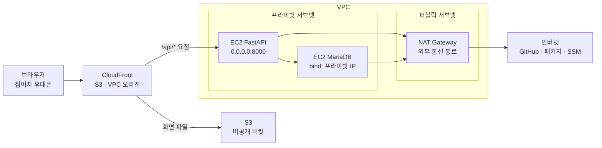

# PACK QUEST PRD

Oct 19, 2026 · @전준호

> 원본은 claude.ai 문서다: https://claude.ai/artifact/6AKY41oNij8j5LerYUYmX3 . 이 파일은 2026-10-19에 내보낸 사본이므로, 원본을 고치면 이 파일도 다시 내보내 올린다.

## 변경 이력

v4.2는 v4.1에서 "설정은 맞는데 연결이 안 되는" 지점 다섯 가지를 반영했고, v4.3은 세 명이 같은 날 동시에 일하도록 역할과 일정을 다시 배치하면서 문서 안의 불일치를 고쳤다.

| 버전 | 반영 내용 | 반영 위치 |
|---|---|---|
| v4.2 | MariaDB bind-address를 DB 서버 프라이빗 IP로 변경 | 구축 절차 단계 11 |
| v4.2 | uvicorn을 `--host 0.0.0.0`으로 실행 | 구축 절차 단계 13, 배포와 운영 방식 |
| v4.2 | S3 버킷 정책에 OAC 허용 정책 추가 | CloudFront 설정 순서, 단계 15 |
| v4.2 | CloudFront 사용자 지정 오류 응답을 설정하지 않음 | CloudFront 설정 순서, 단계 15 |
| v4.2 | 토큰은 `X-Pack-Token` 헤더로 전달, 원본 요청 정책은 Managed-AllViewerAndCloudFrontHeaders-2022-06 | API 공통 규칙, CloudFront 설정 순서 |
| v4.3 | 인계는 하루 끝에만 하고 매일 세 사람이 동시에 일하도록 역할·일정 재배치 | 구축 절차, 팀 역할과 일정 |
| v4.3 | 일정 표와 구축 절차 표의 단계 배치 통일(단계 13과 14는 2일 차) | 구축 절차, 팀 역할과 일정 |
| v4.3 | S3 버킷은 A가 만들고 C는 업로드만 한다(최소 권한과 일치) | 구축 절차 단계 14 |
| v4.3 | 요청 제한용 IP는 CloudFront-Viewer-Address 값에서 포트를 뺀 IP | API 공통 규칙, 보안·권한 설계 |
| v4.3 | 보안 표 네트워크 행의 서버 프로그램 수신 주소 문장 수정 | 보안·권한 설계 |
| v4.4 | AWS 작업은 세 명이 컴퓨터 한 대에서 IAM 사용자 하나로 함께 한다(사람별 SSO·권한 분리 없음, 루트 사용 안 함) | 구축 절차 단계 1, 보안·권한 설계, 팀 역할과 일정 |
| v4.4 | 예산 알람은 계정 권한이 없어 만들지 않고, 매일 비용 확인과 발표 후 즉시 삭제로 대신한다 | 단계 1·17·19, 보안·권한 설계, 비기능 요구사항, 리스크, 인수 기준 |
| v4.5 | AWS 리소스는 에이전트(Claude)가 AWS CLI로 하나씩 만들고, 생성·변경·삭제 명령은 실행 전에 사람이 확인한다. 자격 증명은 `aws login` 임시 자격 증명만 쓴다 | 개요, AWS 아키텍처, 구축 절차, 보안·권한 설계, 인수 기준 |
| v4.6 | (10/21) 회원가입·로그인을 선택 기능 FR-09로 추가. 로그인은 선택이고 비로그인 합류는 유지한다. 여행별 `X-Pack-Token`은 그대로 두고 계정을 참여자에 연결만 한다. 로그인 토큰은 `X-Auth-Token` 헤더로 보낸다. 10/22 정오까지 끝나지 않으면 로그인 없는 버전으로 발표한다 | 범위, 핵심 기능 요구사항, 데이터 모델, API 공통 규칙, 보안·권한 설계 |
| v4.6 | (10/21) FR-08 캐리어 완성도는 분류별이 아니라 팀 전체 완료율로 표시한다(구현에 맞춤) | 핵심 기능 요구사항, 여행 조건과 추천 규칙 |

## 개요

PACK QUEST는 여행 조건을 입력하면 준비물 목록을 자동으로 만들어 주고, 공유 코드로 초대한 친구들과 담당자를 나눠 함께 체크하는 웹앱이며, AWS에 3티어(웹·앱·DB)로 구축한다.

- **문제**: 단체 여행 준비물이 메신저에 흩어져 있어 누가 무엇을 챙기는지 불분명하고, 중복과 누락이 생긴다.
- **해결**: 조건별 추천 목록, 담당자 지정, 완료 체크, 팀 진행률을 한 화면에서 함께 본다.
- **프로젝트 목표**: AWS 3티어 구축 실습(S3·CloudFront, EC2 FastAPI, EC2 MariaDB)과 바이브 코딩 실습이다. 기능은 단순하게 두고 인프라 구축에 무게를 둔다. 리소스는 에이전트가 AWS CLI로 하나씩 만들고 사람이 명령과 결과를 확인하며, 기존에 실습한 기술(EC2, S3, CloudFront, VPC, SSM, FastAPI, MariaDB)을 활용한다. IaC와 자동 배포(CI/CD)는 쓰지 않는다.
- **기간과 산출물**: 10/19(월)~10/23(금) 5일, 금요일에 라이브 데모로 발표한다.
- **팀**: 3명(A 인프라·MariaDB, B 백엔드, C 프론트·발표).

## 대상 사용자와 시나리오

여행 종류를 가리지 않고, 준비물을 나눠 챙겨야 하는 모든 여행 그룹(친구, 가족, 동아리 등)이 대상이다. 사용자는 두 가지 역할로 나뉜다.

| 역할 | 하는 일 | 권한 |
|---|---|---|
| 주최자 | 여행 생성, 공유 코드 전달, 담당자 배정, 여행 삭제 | 주최자 관리 토큰 |
| 참여자 | 코드로 입장, 담당 항목 선택, 완료 체크 | 참여 시 발급된 수정 토큰 |

### 대표 시나리오

1. 주최자가 국내/해외, 이동수단, 기간·계절을 고르고 여행을 만든다.
2. 조건에 맞는 준비물 목록이 자동으로 만들어진다.
3. 주최자가 공유 코드를 친구들에게 보낸다.
4. 친구들이 코드와 닉네임으로 입장한다.
5. 각자 준비물을 맡고, 챙기면 완료로 체크한다.
6. 모두가 팀 진행률과 캐리어 완성도를 본다.
7. 여행이 끝나면 주최자가 여행을 삭제한다.

**배정 권한**: 참여자는 자기 자신에게만 항목을 배정할 수 있고, 다른 사람에게 배정하는 것은 주최자만 할 수 있다.

## 범위

5일 안에 끝내기 위해 MVP는 일곱 가지 필수 기능(FR-01~07)으로 제한하고, 선택 기능은 시간이 남을 때만 진행하며 나머지는 향후 확장으로 미룬다.

| 구분 | 항목 |
|---|---|
| MVP 필수(FR-01~07) | 여행 생성, 조건별 준비물 추천, 공유 코드로 참여, 준비물 관리(추가·삭제), 담당자 지정과 완료 체크, 팀 진행률 표시, 여행 삭제 |
| 선택(시간이 남으면) | 캐리어 완성도 연출(FR-08), 회원가입·로그인(FR-09, 10/21 추가) |
| 향후 확장 | WebSocket 실시간 갱신, AI 기반 추천, 날씨 API 연동, 자동 배포(CI/CD)·IaC, 데이터 자동 만료 |
| 제외 | 결제, 항공·숙박 예약, 지도·경로 안내, 앱 설치형 모바일 앱 |

로그인은 MVP에 넣지 않는다. 수정 권한은 참여 시 발급하는 토큰으로 나눈다. 10/21에 선택 기능 FR-09로 로그인을 추가했지만, 로그인은 선택이고 기존 토큰 권한 검사는 바꾸지 않는다. 계정은 참여자에 연결만 해서 "내 여행 목록"과 다른 기기에서의 참여자 복구에 쓴다. 10/22 정오까지 끝나지 않으면 로그인 없는 버전(main)으로 발표하고 로그인은 향후 확장으로 남긴다.

## 핵심 기능 요구사항

FR-01부터 FR-07까지 7개가 MVP 필수이고, FR-08은 시간이 남을 때만 진행한다.

| ID | 기능 | 설명 | 완료 기준 |
|---|---|---|---|
| FR-01 | 여행 생성 | 국내/해외, 이동수단, 기간, 계절을 입력해 여행을 만든다. 공유 코드와 주최자 토큰이 발급된다. | 생성 직후 공유 코드와 준비물 목록이 화면에 보인다. |
| FR-02 | 준비물 추천 | 입력한 조건에 맞는 준비물 목록을 분류별로 자동 생성한다. | 조건을 바꾸면 추가되는 항목이 달라진다. |
| FR-03 | 코드로 참여 | 공유 코드와 닉네임으로 입장하고 수정 토큰을 발급받는다. | 올바른 코드로 입장하고, 잘못된 코드는 오류 안내가 나온다. |
| FR-04 | 준비물 관리 | 항목을 추가하고 삭제한다. | 변경이 다른 참여자 화면에 반영된다. |
| FR-05 | 담당자 지정과 완료 체크 | 항목마다 담당자를 지정하고, 담당자가 완료로 체크한다. 참여자는 자신에게만, 주최자는 다른 참여자에게도 배정할 수 있다. | 담당자와 완료 상태가 새로고침 후에도 유지된다. |
| FR-06 | 팀 진행률 | 전체 완료율과 참여자별 완료율을 보여준다. | 체크하면 진행률이 갱신된다. |
| FR-07 | 여행 삭제 | 주최자가 여행과 관련 데이터를 삭제한다. | 삭제 후 같은 코드로 입장할 수 없다. |
| FR-08(선택) | 캐리어 완성도 | 팀 전체 완료율만큼 캐리어 그림이 차오르게 시각화한다(10/21 분류별에서 팀 전체로 변경). 새 API 없이 기존 진행률 데이터로 화면에서 계산한다. | 체크 상태에 따라 그림이 바뀐다. |
| FR-09(선택) | 회원가입·로그인 | 아이디·비밀번호·닉네임으로 가입하고 로그인한다(이메일 인증·비밀번호 찾기 없음). 로그인 상태에서 만들거나 합류한 여행은 계정에 연결되고, "내 여행 목록"에서 다시 들어가면 그 여행의 참여자 토큰을 새로 받는다. 로그인하지 않아도 기존처럼 코드와 닉네임으로 합류할 수 있다. | 다른 기기에서 로그인하면 내 여행 목록이 보이고 같은 참여자로 다시 들어간다. 로그인 실패 시 아이디 존재 여부를 알려 주지 않는다. |

화면 갱신은 MVP에서 5초 간격 폴링으로 처리한다. 같은 항목을 동시에 수정하면 마지막 저장이 적용된다.

## 여행 조건과 추천 규칙

준비물 추천은 AI 없이 규칙으로 처리한다. 공통 기본 목록에 조건별 추가 항목을 합치고 중복을 제거해서 목록을 만든다.

| 조건 | 선택지 | 추가되는 준비물 예시 |
|---|---|---|
| 국내/해외 | 국내, 해외 | 해외: 여권, 환전, 유심·로밍, 멀티 어댑터. 국내: 신분증 |
| 이동수단 | 비행기, 자동차, 기차 | 비행기: 탑승권, 기내 반입 규정 확인. 자동차: 운전면허증, 차량용 충전기, 멀미약. 기차: 승차권 |
| 기간 | 당일, 1~2박, 3박 이상 | 기간이 길수록 의류·세면·상비약 항목 확대 |
| 계절 | 봄·가을, 여름, 겨울 | 여름: 선크림, 모자. 겨울: 핫팩, 장갑 |

준비물은 서류, 의류, 세면, 전자기기, 건강·안전, 기타의 여섯 분류로 나눈다. 캐리어 완성도는 분류와 상관없이 팀 전체 완료율로 표시한다.

- 추천 목록은 코드에 포함된 정적 데이터(JSON)로 두고, 앱 서버가 조건에 맞게 합쳐 반환한다.
- 시작은 공통 항목 20~30개로 하고, 조건별 항목은 시간이 되는 만큼 늘린다.
- 생성된 목록에서 항목 추가·삭제가 가능하다. 추천은 참고용이며 최종 판단은 사용자가 한다.

## 데이터 모델과 공유 코드

EC2에 직접 설치한 MariaDB의 테이블 세 개에 여행, 참여자, 준비물을 나눠 저장한다(FR-09를 하면 계정·로그인 세션 테이블 두 개가 더해진다). 공유 코드는 여행 테이블의 기본 키이므로, 코드 하나로 그 여행에 연결된 모든 데이터를 조회한다.

| 테이블 | 기본 키 | 주요 컬럼 | 관계 |
|---|---|---|---|
| trips | code(공유 코드) | 국내/해외, 이동수단, 기간, 계절, 주최자 토큰 해시, 생성 시각 | 최상위 |
| members | id | trip_code, 닉네임, 수정 토큰 해시, 입장 시각, user_id(FR-09, 비어 있을 수 있음) | trips.code, users.id 참조 |
| items | id | trip_code, 이름, 분류, 담당자 ID(비어 있을 수 있음), 완료 여부, 출처(추천/직접 추가) | trips.code, members.id 참조 |
| users(FR-09) | id | 아이디(고유), 비밀번호 해시, 닉네임, 가입 시각 | 최상위 |
| sessions(FR-09) | 로그인 토큰 해시 | user_id, 만료 시각, 발급 시각 | users.id 참조 |

- **공유 코드**: 8자리 이상의 랜덤 값이며, 헷갈리는 글자는 뺀다.
- **토큰**: 서버는 토큰 원문이 아니라 해시만 저장한다. 원문은 발급 시 한 번만 응답하고 브라우저에 보관한다. 로그인 토큰도 같은 방식(무작위 값, 해시만 저장)이라 별도 서명 키가 없다.
- **비밀번호(FR-09)**: scrypt·bcrypt·argon2 같은 느린 해시(현재 구현 scrypt)만 저장하고 평문은 DB·로그 어디에도 남기지 않는다.
- **쿼리**: 모든 쿼리는 파라미터 바인딩으로 작성하고, 문자열을 이어 붙여 만들지 않는다. 테이블 생성 SQL(schema.sql)은 GitHub로 공유하되 비밀번호와 인증 정보는 올리지 않는다.
- **진행률**: 완료 여부를 SQL로 집계해 계산한다.
- **삭제**: 주최자가 여행을 삭제하면 외래 키의 연쇄 삭제(ON DELETE CASCADE)로 참여자와 준비물이 함께 지워진다.
- **백업**: 자동 백업이 없으므로 DB 서버에서 mysqldump로 백업 파일을 만들고, AWS 콘솔에서 EBS 스냅샷도 만든다. 발표 전날 한 번은 백업하고 복원 방법을 확인한다.
- **보관**: 주최자가 삭제할 때까지 보관한다(자동 만료 없음). 방치된 여행과 유효한 공유 코드가 남는 점은 알려진 한계이며, 2단계에서 자동 만료를 검토한다.

## API 공통 규칙

모든 API는 `/api` 아래에 두고, 토큰은 `X-Pack-Token` 헤더로 보낸다. 세부 엔드포인트와 요청·응답 형식은 1일 차 API 명세에서 확정하되, 아래 규칙은 고정한다.

| 항목 | 규칙 | 이유 |
|---|---|---|
| 경로 | 모든 API 경로는 `/api` 아래에 둔다(예: `/api/trips`). | CloudFront가 `/api/*`를 경로 그대로 FastAPI로 전달한다. |
| 토큰 헤더 | 주최자 토큰과 수정 토큰은 모두 `X-Pack-Token` 헤더로 보낸다. `Authorization` 헤더는 쓰지 않는다. | `Authorization`은 CloudFront에서 캐시 정책과 엮여 따로 취급되므로, 사용자 지정 헤더가 원본까지 확실히 전달된다. |
| 토큰 보관 | 화면은 토큰을 여행 코드별로 브라우저에 보관한다. 새로고침 후에도 같은 참여자로 남아야 한다. | 로그인이 없어서 토큰이 참여자를 구분하는 유일한 수단이다. |
| 로그인 토큰(FR-09) | 로그인 토큰은 `X-Auth-Token` 헤더로 보낸다. 쿠키와 `Authorization` 헤더는 쓰지 않는다. 여행 권한은 계속 `X-Pack-Token`으로 검사한다. | `X-Pack-Token`과 같은 방식이라 CloudFront 설정을 바꾸지 않아도 원본 요청 정책으로 서버까지 전달된다. |
| 상태 확인 | `/api/health`는 토큰 없이 응답한다. | 서버 안 점검과 CloudFront 연결 확인에 쓴다. |
| 오류 형식 | `{"detail": {"code":"...","message":"..."}}` | 화면이 코드별로 안내 메시지를 보여준다. 오류 코드 목록은 API 명세에 적는다. |
| 사용자 IP | 요청 제한은 `CloudFront-Viewer-Address` 헤더의 IP를 기준으로 한다. 이 값은 `IP:포트` 형식이므로 포트를 뺀 IP만 쓴다. IPv6의 실제 형식은 3일 차에 서버 로그로 확인한다. | CloudFront 뒤에서는 연결 주소가 CloudFront 내부 IP로 보인다. 포트를 빼지 않으면 접속마다 다른 사용자로 보여 요청 제한이 작동하지 않는다. |

## AWS 아키텍처

화면은 S3와 CloudFront로 서비스하고, API는 CloudFront 뒤의 EC2(Ubuntu + FastAPI)가 처리하며, 데이터는 별도 EC2(Ubuntu)에 직접 설치한 MariaDB에 저장하는 3티어 구성이다. 리소스는 에이전트가 AWS CLI로 하나씩 만들고 사람이 확인한다.

**인터넷에서 들어오는 길은 CloudFront뿐이고 서버는 NAT로만 밖에 나간다**

*AWS 3티어 아키텍처 · 7개 구성요소*

브라우저는 CloudFront 도메인 하나로 접속한다. CloudFront는 화면 요청을 S3로, `/api/*` 요청을 프라이빗 서브넷의 FastAPI 서버로 전달한다(VPC 오리진). 인터넷에서 서버로 들어오는 길은 CloudFront뿐이고, MariaDB 서버의 3306 포트에는 FastAPI 서버만 접근할 수 있다. 두 서버가 패키지를 받고 GitHub와 SSM에 접속하는 나가는 길은 퍼블릭 서브넷의 NAT Gateway 하나로 통일한다. 사용자 지정 도메인(Route 53, ACM)은 MVP에 필요하지 않고 기본 CloudFront 도메인을 쓴다.

티어별 구성은 다음과 같다. DB를 EC2에 직접 설치하므로 설치, 설정, 패치, 백업은 팀이 직접 관리하고, 서버 접속은 기존 실습처럼 SSM Session Manager를 쓴다.

| 티어 | AWS 구성 | 역할 | 네트워크 |
|---|---|---|---|
| 웹 | S3 + CloudFront(기본 CloudFront 도메인) | HTML/CSS/JavaScript 화면을 제공하고, `/api/*` 요청을 앱 서버로 전달 | S3는 비공개이며 CloudFront(OAC)로만 접근 |
| 앱 | EC2(Ubuntu + FastAPI) | API 처리, 추천 목록 생성, 권한 검사 | 프라이빗 서브넷, CloudFront(VPC 오리진)에서 오는 요청만 허용. uvicorn은 0.0.0.0에 바인딩 |
| DB | EC2(Ubuntu + MariaDB 직접 설치) | 여행·참여자·준비물 저장 | 프라이빗 서브넷, 앱 서버에서 오는 3306 연결만 허용. bind-address는 DB 서버 프라이빗 IP |
| 서버 관리 | SSM Session Manager | 두 서버 접속과 배포 작업 | 22번 포트 없음, 사람별 권한 |

## 네트워크 구성

VPC 하나에 퍼블릭 서브넷(NAT Gateway 전용)과 프라이빗 서브넷 두 개(앱, DB)를 두고, 인터넷에서 서버로 들어오는 길은 CloudFront 하나로 제한한다. 리소스는 같은 가용 영역에 둔다.

| 리소스 | 설정 |
|---|---|
| VPC | 하나(예: CIDR 10.0.0.0/16). 인터넷 게이트웨이를 연결한다(VPC 오리진 사용 조건이기도 하다). |
| 퍼블릭 서브넷 1개 | NAT Gateway 전용. 라우팅 테이블: 0.0.0.0/0 → 인터넷 게이트웨이 |
| 프라이빗 서브넷 2개 | 앱 서브넷(FastAPI)과 DB 서브넷(MariaDB). 라우팅 테이블: 0.0.0.0/0 → NAT Gateway |
| 보안 그룹 sg-app | 인바운드: FastAPI 포트(예: 8000)를 CloudFront에서 오는 요청만 허용한다(아래 "허용 규칙" 참고). 22번 포트는 열지 않는다. |
| 보안 그룹 sg-db | 인바운드: 3306을 sg-app에서만 허용한다. 그 외 인바운드는 없다. |

**나가는 통신 경로**: 두 서버는 공인 IP가 없어서 밖으로 나가는 통신은 모두 NAT Gateway를 지난다.

| 필요한 통신 | 경로 | 비고 |
|---|---|---|
| 패키지 설치(apt, pip) | 프라이빗 서버 → NAT Gateway → 인터넷 게이트웨이 | NAT Gateway가 없으면 설치할 수 없다. |
| GitHub에서 코드 받기 | Backend 서버 → NAT Gateway → GitHub | Backend 서버만 필요하다. DB 서버는 GitHub에 접속하지 않는다. |
| SSM Session Manager 접속 | 서버의 SSM 에이전트 → NAT Gateway → SSM 서비스 | 기본 경로. 대안은 VPC 엔드포인트 3개(ssm, ssmmessages, ec2messages)이며 SSM만 NAT 없이 가능하다. |
| DB 비밀번호 읽기 | Backend 서버 → NAT Gateway → Parameter Store | Backend 서버만 필요하다. |
| 사용자 요청 | 브라우저 → CloudFront → S3 또는 VPC 오리진 → FastAPI | 서버에 공인 IP가 없다. FastAPI는 0.0.0.0에서 들어야 CloudFront 요청을 받는다. |
| API → DB | Backend 서버 → DB 서버(3306) | 프라이빗 서브넷 안의 통신이며 NAT를 쓰지 않는다. MariaDB bind-address가 프라이빗 IP여야 받는다. |

VPC 엔드포인트만으로는 패키지 설치와 GitHub 접속이 되지 않고 엔드포인트도 시간당 과금되므로, 이번에는 NAT Gateway 하나로 통일한다.

**CloudFront `/api/*` 연결(VPC 오리진) 조건**: AWS 공식 문서에서 확인한 내용이다.

- VPC가 VPC 오리진을 지원하는 리전에 있어야 한다. 서울(ap-northeast-2)은 지원 목록에 있다.
- VPC에 인터넷 게이트웨이가 있어야 하고, 프라이빗 서브넷에 사용 가능한 IPv4 주소가 하나 이상 있어야 한다. CloudFront가 그 서브넷에 관리형 네트워크 인터페이스를 만든다.
- 원본 EC2는 프라이빗 서브넷에서 실행 중이고 보안 그룹이 붙어 있어야 한다.
- VPC 오리진을 만들면 CloudFront가 서비스 관리형 보안 그룹(이름이 CloudFront-VPCOrigins-Service-SG로 시작)을 자동으로 만든다. 이 보안 그룹은 수정하지 않으며, 같은 이름 패턴으로 직접 보안 그룹을 만들면 안 된다.
- gRPC와 Lambda@Edge의 원본 요청·응답 트리거는 지원하지 않는다. 이 프로젝트는 쓰지 않는다.
- 네트워크 ACL의 인바운드 규칙은 CloudFront에서 오는 트래픽에 적용되지 않는다. 기본 ACL을 그대로 쓰면 영향이 없다.

**허용 규칙(sg-app)**: 서비스 관리형 보안 그룹을 허용하는 방식이 기본이다. 내 CloudFront 배포에서 온 요청만 통과시킨다. 이 방식은 VPC 오리진을 만든 뒤에만 설정할 수 있어서, 만들기 전에 연결 확인이 필요하면 CloudFront 관리형 접두사 목록(`com.amazonaws.global.cloudfront.origin-facing`)을 임시로 허용했다가 오리진이 Deployed 상태가 되면 서비스 관리형 보안 그룹 규칙으로 바꾸고 접두사 목록 규칙은 지운다. 접두사 목록을 계속 쓰면 다른 사람의 CloudFront 배포에서 온 요청도 통과한다.

### CloudFront 설정 순서

1. Backend EC2가 실행 중이고, FastAPI가 `0.0.0.0:8000`에서 응답하는 것을 확인한다(서버 안에서 `curl http://<프라이빗 IP>:8000/api/health`).
2. CloudFront 콘솔에서 VPC 오리진을 만든다. 원본 ARN에 Backend EC2를 지정하고, 상태가 Deployed로 바뀔 때까지 기다린다(최대 15분).
3. 배포에 원본 두 개를 둔다. 하나는 S3(OAC, 기본 동작), 다른 하나는 VPC 오리진이다. EC2를 원본으로 쓸 때는 원본 도메인에 인스턴스의 프라이빗 IP DNS 이름을 붙여 넣는다.
4. S3 버킷 정책에 OAC 허용 정책을 붙인다. 배포를 만들면 콘솔이 복사할 버킷 정책을 보여준다. 이 정책을 S3 버킷의 권한 → 버킷 정책에 붙여 넣지 않으면 화면 요청이 403으로 실패한다.
5. `/api/*` 동작을 VPC 오리진으로 연결한다.
   - 캐시 정책: Managed-CachingDisabled
   - 원본 요청 정책: Managed-AllViewerAndCloudFrontHeaders-2022-06. `X-Pack-Token` 헤더, 쿼리 문자열, `CloudFront-Viewer-Address` 헤더가 원본까지 전달된다.
   - 허용 메서드: GET, HEAD, OPTIONS, PUT, POST, PATCH, DELETE 전부
6. 원본 프로토콜과 포트는 FastAPI가 듣는 값과 맞춘다(HTTP, 8000).
7. 사용자 지정 오류 응답(Error pages)은 설정하지 않는다. 403/404 → index.html 같은 규칙은 배포 전체에 적용되어, API가 보낸 403/404 JSON 오류까지 index.html로 바뀐다. 이 앱은 SPA 라우팅이 필요 없으므로 비워 둔다.
8. CloudFront는 경로를 그대로 전달하므로 FastAPI의 모든 API 경로를 `/api` 아래에 만든다(예: `/api/trips`).

**기존 실습과의 관계**: 기존 실습에서 쓴 API 연결 방식은 이 계획을 쓰는 시점에 확인되지 않았다. 팀(담당 A)이 이전 실습 기록에서 확인해, 같은 구조를 이번 프로젝트에 쓸 수 있으면 그 방식을 먼저 쓴다. 확인되지 않으면 위 VPC 오리진 방식을 새로 시도하는 구성으로 보고 1~2일 차에 먼저 검증한다. 둘 다 막힐 때의 대안은 FastAPI 서버를 퍼블릭 서브넷에 두고 접두사 목록만 허용하는 방식인데, 서버에 공인 IP가 붙어 인터넷에서 보이므로 팀이 합의한 마지막 수단으로만 쓴다.

## AWS 콘솔 구축 절차

모든 리소스는 아래 순서대로 에이전트가 AWS CLI로 만든다. 생성·변경·삭제 명령은 실행 전에 사람이 확인하고, 결과는 조회 명령과 콘솔로 확인한다. 명령은 하나씩 실행하며 IaC나 일괄 생성 스크립트는 쓰지 않는다. 만든 직후 이름과 설정값을 이 표 옆이나 팀 문서에 기록하고, 비밀번호는 기록하지 않는다. 리소스 이름은 `packquest-` 접두사로 통일한다.

### 1일 차: 기본 인프라(단계 1~7)

| 순서 | 담당 | 작업과 핵심 설정 | 확인 |
|---|---|---|---|
| 1 | A | 작업용 컴퓨터 한 대에서 제공받은 IAM 사용자로 콘솔에 로그인하고(루트 사용 안 함), 같은 사용자로 `aws login`을 해 CLI 임시 자격 증명을 받는다. `aws sts get-caller-identity`의 계정이 콘솔 계정과 같은지 확인한다. 필요한 서비스 권한이 있는지 1일 차 오전에 먼저 확인하고, 없으면 바로 강사·관리자에게 요청한다. 액세스 키는 만들지 않는다. 예산 알람은 권한이 없어 만들지 않는다. | 콘솔과 CLI가 같은 계정·사용자로 로그인되고, 필요한 권한이 확인된다. |
| 2 | A | VPC를 만들고 인터넷 게이트웨이를 만들어 연결한다. | 인터넷 게이트웨이가 Attached 상태다. |
| 3 | A | 같은 가용 영역에 서브넷 3개를 만든다. 퍼블릭 1개(NAT용), 프라이빗 2개(앱, DB). 프라이빗 서브넷은 공인 IP 자동 할당을 끈다. | 서브넷 3개가 보인다. |
| 4 | A | 라우팅 테이블 2개를 만든다. 퍼블릭: 0.0.0.0/0 → 인터넷 게이트웨이, 퍼블릭 서브넷에 연결. 프라이빗: 프라이빗 서브넷 2개에 연결. | 서브넷별 연결이 맞다. |
| 5 | A | 퍼블릭 서브넷에 NAT Gateway를 만들고 Elastic IP를 할당한다. 만든 뒤 프라이빗 라우팅 테이블에 0.0.0.0/0 → NAT Gateway를 추가한다. | NAT Gateway가 Available이다. 이 시점부터 상시 과금된다. |
| 6 | A | 보안 그룹을 만든다. sg-app을 먼저(인바운드 없음으로 시작), sg-db를 그다음(인바운드 3306을 sg-app에서만 허용). | sg-db의 소스가 sg-app 하나뿐이다. |
| 7 | A | EC2용 IAM 역할 두 개를 만든다. 둘 다 AmazonSSMManagedInstanceCore를 붙이고, Backend용에만 Parameter Store의 `/packquest/db-password` 하나를 읽는 권한을 더한다. | 역할 두 개와 권한이 확인된다. |

### 2일 차: 서버, DB, S3(단계 8~14)

처리 순서는 단계 9(Backend 서버)를 먼저 만들어 B에게 넘긴 뒤 8, 10, 11, 12를 진행하고, 단계 14의 버킷도 2일 차 오전에 만든다. 그래야 B와 C가 기다리지 않고 단계 13과 뼈대 화면 업로드를 같은 날 할 수 있다.

| 순서 | 담당 | 작업과 핵심 설정 | 확인 |
|---|---|---|---|
| 8 | A | DB 서버를 만든다. Ubuntu, DB 서브넷, 공인 IP 없음, sg-db, DB용 역할, 키 페어 없음, 디스크 암호화. | 상태 검사를 통과한다. |
| 9 | A | Backend 서버를 만든다(가장 먼저 만들어 B에게 넘긴다). Ubuntu, 앱 서브넷, 공인 IP 없음, sg-app, Backend용 역할, 키 페어 없음, 디스크 암호화. | 상태 검사를 통과한다. |
| 10 | A, B | 콘솔의 Session Manager로 두 서버에 접속한다. 안 되면 NAT 경로, 역할, SSM 에이전트 상태 순서로 확인한다. | A는 DB 서버, B는 Backend 서버에 접속한다. |
| 11 | A | DB 서버에 MariaDB를 설치하고 시작·자동 시작을 설정한다. root 원격 로그인을 막고 익명 사용자와 테스트 DB를 지운다. `/etc/mysql/mariadb.conf.d/50-server.cnf`의 `bind-address`를 DB 서버 프라이빗 IP로 바꾸고 MariaDB를 재시작한다(기본값 127.0.0.1이면 Backend에서 접속이 거부된다). DB(packquest)를 만들고, 앱 전용 계정을 Backend 서버의 프라이빗 IP에서만 접속하게 만들어 그 DB의 SELECT, INSERT, UPDATE, DELETE만 준다. schema.sql은 SSM 세션에 붙여 넣어 실행한다. 비밀번호는 무작위로 만들고 채팅에 남기지 않는다. | bind-address가 프라이빗 IP다. Backend 서버에서 앱 계정으로 접속되고, 다른 경로와 root 원격 접속은 실패한다. |
| 12 | A | Parameter Store에 SecureString으로 `/packquest/db-password`를 만든다. | Backend 역할만 읽을 수 있다. |
| 13 | B (A 지원) | Backend 서버에 Python 가상환경과 의존성을 설치한다. GitHub 읽기 전용 Deploy key를 만들어 저장소에 등록하고 코드를 받는다. DB 호스트·계정·파라미터 이름을 서비스 설정에 지정하고(비밀번호는 지정하지 않는다), 일반 사용자로 systemd 서비스를 등록해 자동 시작하게 한다. uvicorn은 `--host 0.0.0.0 --port 8000`으로 실행한다(127.0.0.1이면 CloudFront 요청이 거부되어 502가 난다). 외부 차단은 sg-app이 맡는다. 서버는 시작할 때 Parameter Store에서 boto3로 DB 비밀번호를 읽고(리전 지정 필요), 로컬 개발에서는 환경 변수로 대체한다. 2일 차에는 `/api/health`만 응답하는 뼈대로 먼저 가동하고, 3일 차에 실제 코드로 바꾼다. | 서버 안에서 `curl http://<프라이빗 IP>:8000/api/health`가 응답한다. DB 연결은 실제 코드를 올린 뒤 확인한다. |
| 14 | A(버킷), C(업로드) | A가 S3 버킷을 만들고 퍼블릭 액세스를 모두 차단한다(정적 웹 호스팅 기능은 쓰지 않는다). C가 화면 파일(index.html 등)을 업로드한다. 버킷은 2일 차 오전에 만들고, 뼈대 화면은 2일 차 안에 올린다. | 콘솔에서 파일이 보인다. |

### 3일 차: CloudFront와 통합(단계 15~16)

| 순서 | 담당 | 작업과 핵심 설정 | 확인 |
|---|---|---|---|
| 15 | A | "네트워크 구성"의 CloudFront 설정 순서대로 VPC 오리진과 배포를 만든다. VPC 오리진이 Deployed가 될 때까지 기다리는 동안 설정값을 기록한다. S3는 OAC로 연결하고 기본 루트 객체를 `index.html`로 둔다. 콘솔이 보여주는 OAC 버킷 정책을 S3 버킷 정책에 붙인다. `/api/*` 원본 요청 정책은 Managed-AllViewerAndCloudFrontHeaders-2022-06으로 한다. 사용자 지정 오류 응답은 설정하지 않는다. sg-app에 CloudFront 허용 규칙을 추가·교체한다. | CloudFront 도메인에서 화면이 열린다(403 아님). `/api/health`가 JSON으로 응답한다. 없는 코드로 참여하면 HTML이 아닌 JSON 오류가 온다. |
| 16 | A, B, C | CloudFront 도메인에서 여행 생성 → 참여 → 체크 → 진행률 → 삭제를 끝까지 해 본다. | 모든 단계가 동작한다. |

### 4~5일 차: 점검과 마무리(단계 17~19)

| 순서 | 담당 | 작업과 핵심 설정 | 확인 |
|---|---|---|---|
| 17 | A, B, C | 네트워크·권한 점검을 세 갈래로 나눠 동시에 한다. **A(콘솔)**: 두 서버에 공인 IP와 22번 포트가 없는지, sg 규칙과 3306 범위, 역할 권한, S3 비공개, 현재 비용. **B(서버 안)**: 포트 수신 주소, 서비스 재시작 후 자동 시작, DB 앱 계정 권한과 root 원격 접속 차단, 저장소와 서버에 비밀번호가 없는지. **C(브라우저)**: S3 주소로 직접 접근하면 막히는지, CloudFront 도메인에서 API 오류가 HTML이 아닌 JSON으로 오는지, 핵심 흐름. | 인수 기준의 보안 항목이 모두 통과한다. |
| 18 | 각자 | 자신이 만든 리소스의 이름·설정값을 팀 문서에 기록한다(비밀번호 제외). | 다른 팀원이 문서만 보고 같은 환경을 설명할 수 있다. |
| 19 | A (B, C 확인) | 발표 후 삭제 순서: CloudFront 배포(비활성화 후 삭제) → VPC 오리진 → EC2 두 대 → NAT Gateway → Elastic IP → S3(비운 뒤 삭제) → 보안 그룹, 서브넷, 라우팅 테이블, 인터넷 게이트웨이, VPC → Parameter Store, IAM 역할 순으로 정리한다. 보관할 백업이 있는지 먼저 정하고, B와 C가 순서 체크리스트를 읽어 주며 확인한다. | 청구 화면에서 상시 과금 항목이 남지 않는다. |

## 배포와 운영 방식

GitHub는 코드 공유와 버전 관리에만 쓰고 자동 배포는 쓰지 않는다. 모든 배포는 사람이 직접 하며, 배포할 때마다 배포한 사람, 시간, 커밋을 팀 채팅에 남긴다. 개발 중에는 각자 PC에서 실행하고, 작업은 각자 브랜치에서 한 뒤 3일 차에 합친다. 합치기 전에 다른 팀원이 한 번 확인한다.

### 프론트엔드(담당 C)

1. 개인 PC의 VS Code에서 HTML/CSS/JavaScript를 개발한다. API는 상대 경로(`/api/...`)로 부르고, 토큰은 `X-Pack-Token` 헤더로 보낸다.
2. 코드를 GitHub 저장소에 올려 팀원과 공유한다.
3. 최종 코드를 AWS 콘솔로 S3 버킷에 수동 업로드한다.
4. 화면이 바뀌지 않으면 CloudFront 캐시 무효화를 실행한다.
5. CloudFront 도메인에서 정상 동작을 확인한다.

### 백엔드(담당 B)

1. 개인 PC의 VS Code에서 Python FastAPI를 개발한다. 모든 API 경로는 `/api` 아래에 두고, 토큰은 `X-Pack-Token` 헤더에서 읽는다.
2. 코드를 GitHub 저장소에 올린다.
3. Backend 서버에 SSM Session Manager로 접속한다.
4. GitHub에서 코드를 받고(`git pull`), 의존성이 바뀌었으면 가상환경에서 설치한다(`pip install -r requirements.txt`).
5. FastAPI를 systemd 서비스로 실행한다. 실행 명령은 `uvicorn ... --host 0.0.0.0 --port 8000`이다. 서비스 등록은 처음 한 번만 하고(2일 차에 뼈대로 먼저), 이후에는 재시작만 한다.
6. 코드가 바뀌면 같은 방식으로 최신 코드를 받아 서비스를 재시작한다(`systemctl restart`).
7. API 요청과 MariaDB 연결 상태를 확인한다(서비스 상태와 `journalctl` 로그).

### 데이터베이스(담당 A)

1. DB 서버에 MariaDB를 설치한다.
2. `bind-address`를 DB 서버 프라이빗 IP로 바꾸고 재시작한다.
3. DB와 테이블을 만든다(schema.sql).
4. Backend 서버의 접근만 허용한다(sg-db와 DB 계정의 접속 위치 제한).
5. 앱 전용 계정에 최소 권한만 준다.
6. SQL 스크립트는 GitHub로 공유하되 비밀번호와 인증 정보는 올리지 않는다.

### 배포 전후 체크리스트

- [ ] 저장소에 비밀번호, 키, .env 파일이 없다(.gitignore 확인).
- [ ] Backend 서버에서 최신 커밋을 받았고 커밋 번호를 기록했다.
- [ ] 서비스가 active 상태이고 오류 로그가 없다.
- [ ] CloudFront 도메인에서 핵심 흐름을 한 번 해 봤다.
- [ ] 배포한 사람, 시간, 커밋을 팀 채팅에 남겼다.

## 보안·권한 설계

로그인이 없는 공개 서비스이므로 자격 증명은 임시로, 권한은 최소로, 접근 주소는 추측할 수 없게 설계한다. 아래 표의 "기본"을 따르고, "대안"은 기본이 불가능할 때만 위험을 감수하고 쓴다.

| 영역 | 기본(안전) | 대안(덜 안전)과 위험 |
|---|---|---|
| 개발자 AWS 접근 | 세 명이 컴퓨터 한 대에 함께 앉아 제공받은 IAM 사용자 하나로 작업한다. 콘솔 로그인 정보는 그 컴퓨터 밖으로 옮기지 않고(채팅·문서에 적지 않음), 에이전트의 CLI 작업은 `aws login`으로 받은 임시 자격 증명으로만 한다. 루트 계정은 쓰지 않고 액세스 키는 만들거나 CLI에 설정하지 않는다. | 로그인 정보나 액세스 키를 팀원 각자의 PC로 나눠 가짐. 누가 무엇을 했는지 알 수 없고 유출 경로가 늘어난다. 루트 계정 사용과 장기 액세스 키는 유출되면 요금 폭탄이나 계정 탈취로 이어질 수 있으므로 하지 않는다. |
| 작업별 권한 | 사람별 권한은 나누지 않는다(한 자리에서 함께 작업). 대신 에이전트가 실행하는 생성·변경·삭제 명령은 사람이 실행 전에 확인하고, 다른 사람이 만든 네트워크·보안 그룹·IAM 역할·CloudFront 설정은 바꾸기 전에 담당자에게 말한다. 서버 쪽 권한(EC2 역할, DB 앱 계정)은 최소로 둔다. | 에이전트 명령을 확인 없이 실행하거나 서로 알리지 않고 설정 변경. 의도하지 않은 리소스 변경과 원인을 모르는 연결 오류가 생긴다. |
| GitHub 접근(서버) | Backend 서버에는 저장소 읽기 전용 자격 증명(Deploy key 또는 해당 저장소만 읽는 토큰)만 둔다. DB 서버에는 GitHub 자격 증명을 두지 않고, schema.sql은 SSM 세션에서 붙여 넣어 실행한다. | 개인 계정 비밀번호나 모든 저장소에 권한이 있는 개인 토큰을 서버에 저장. 서버가 뚫리면 팀원의 다른 저장소까지 노출된다. |
| 서버 접속 | 두 서버 모두 SSM Session Manager로 접속한다. 22번 포트를 열지 않고 키 페어도 만들지 않는다. | SSH 키 + 22번 포트 개방. 키가 유출되거나 포트가 노출되면 서버에 직접 접속될 수 있고 무차별 로그인 시도에 계속 노출된다. 쓴다면 내 IP만 허용하고 발표 후 닫는다. |
| 네트워크 | 인터넷에서 서버로 들어오는 길은 CloudFront뿐이다. 두 서버는 공인 IP 없이 프라이빗 서브넷에 두고, CloudFront(VPC 오리진) → sg-app(FastAPI 포트) → sg-db(3306) 순서로 앞 단계에서 오는 연결만 허용한다. 서버 프로그램은 서브넷 안에서 접속을 받되(uvicorn은 0.0.0.0, MariaDB는 프라이빗 IP), 실제 차단은 보안 그룹이 맡는다. 나가는 통신은 NAT Gateway로만 한다. | FastAPI 서버를 퍼블릭 서브넷에 두고 CloudFront 관리형 접두사 목록만 허용. 서버에 공인 IP가 붙어 인터넷에 직접 노출되고, 다른 CloudFront 배포에서 온 요청도 통과할 수 있다. VPC 오리진이 막힐 때의 마지막 수단으로만 쓴다. |
| DB 서버 보호 | 앱 전용 계정(해당 DB의 SELECT, INSERT, UPDATE, DELETE만)으로 연결하고 root 원격 로그인을 막는다. 3306은 sg-app에서만 허용하고 디스크(EBS)는 암호화한다. | DB 포트를 넓게 열거나 root 계정으로 앱을 연결. 포트가 인터넷에 열리면 비밀번호 대입 공격과 데이터 유출 위험이 생기고, root로 연결하면 앱이 뚫릴 때 DB 전체가 위험해진다. |
| DB 비밀번호 | Systems Manager Parameter Store(SecureString)에 보관하고, Backend 서버 역할이 그 파라미터 하나만 읽게 한다. 코드와 GitHub에는 비밀번호를 넣지 않는다. | 서버의 .env 파일에 저장(권한 600, Git 제외). 파일이 저장소에 올라가면 바로 유출되고 서버가 뚫리면 파일째 읽힌다. 쓴다면 .gitignore에 넣고 배포 전에 저장소에 올라가지 않았는지 확인한다. |
| 백업 | DB 서버에서 mysqldump로 백업 파일을 만들고, AWS 콘솔에서 EBS 스냅샷도 만든다. | 백업 없음. DB 서버가 망가지면 데이터를 복구할 수 없다. |
| 서버 권한 | 두 서버의 EC2 역할에 SSM 접속 권한(AmazonSSMManagedInstanceCore)을 붙이고, Backend 역할에만 위 파라미터 읽기를 더한다. 서버에 액세스 키를 저장하지 않는다. | 서버에 관리자 권한이나 액세스 키를 둠. 서버가 뚫리면 계정 전체로 번진다. |
| SQL 안전 | 모든 쿼리를 파라미터 바인딩으로 작성하고 입력을 검증한다. | 문자열을 이어 붙여 쿼리 작성. SQL 인젝션으로 다른 여행의 데이터가 노출되거나 삭제될 수 있다. |
| S3 | 버킷은 비공개로 두고(퍼블릭 액세스 차단) CloudFront(OAC)로만 접근한다. 버킷 정책에는 콘솔이 만든 OAC 허용 정책만 둔다. | 버킷 공개. 의도하지 않은 파일이 노출될 수 있다. |
| API 보호 | FastAPI에서 요청 제한과 입력 검증을 적용하고, 화면과 API를 같은 도메인으로 서비스해 CORS를 열지 않는다. 요청 제한의 사용자 구분은 `CloudFront-Viewer-Address` 헤더의 IP(포트 제외)로 하고, 토큰은 `X-Pack-Token` 헤더로만 받는다. 시간이 되면 CloudFront에 WAF 요청 제한을 추가한다(선택). | 요청 제한 없음. 반복 호출로 서버가 느려지거나 비용이 늘 수 있다. WAF는 소액의 비용이 들고 설정이 늘어 선택으로 둔다. |
| 계정(FR-09) | 비밀번호는 scrypt·bcrypt·argon2 같은 느린 해시(현재 구현 scrypt)로 저장하고, 로그인 토큰은 무작위 값의 해시만 저장한다. 로그인 실패 메시지는 아이디 존재 여부를 알려 주지 않고, 로그인 API에 요청 제한을 건다. 요청 로그에는 메서드·경로·상태·IP·오류 코드만 남기고 헤더·본문은 남기지 않아 비밀번호·토큰이 로그에 찍히지 않게 한다. | 평문·가역 암호화로 비밀번호 저장, 로그인 실패 무제한 허용. DB가 유출되면 비밀번호가 그대로 노출되고, 비밀번호 대입 공격을 막을 수 없다. |
| 공유 코드 | 8자리 이상, 헷갈리는 글자(0/O, 1/I 등) 제외, 요청 제한과 함께 쓴다. | 6자리 이하의 짧은 코드. 무차별 대입으로 다른 팀의 여행 방에 들어올 수 있다. |
| 수정 권한 | 참여 시 서버가 수정용 토큰을 발급하고 본인 항목만 수정하게 한다. 방 삭제·설정 변경과 다른 사람에게 항목 배정은 주최자 토큰으로만 한다. | 닉네임만으로 수정. 다른 사람이 같은 닉네임으로 응답을 덮어쓸 수 있다. |
| 비용 보호 | 예산 알람은 계정 권한이 없어 만들지 않는다. 대신 매일 작업 끝에 비용과 실행 중인 리소스(EC2, NAT Gateway, Elastic IP)를 확인하고, 발표 후 삭제 순서에 따라 바로 삭제한다. | 확인 없이 방치. 지우지 않은 리소스에서 요금이 계속 나와도 알 수 없다. |

개인정보는 닉네임만 저장하고(FR-09를 하면 아이디와 비밀번호 해시가 더해진다) 이메일·전화번호는 수집하지 않는다.

## 비기능 요구사항

- **반응형**: 청중이 휴대폰으로 접속하므로 모바일 화면에서 모든 핵심 기능을 쓸 수 있어야 한다.
- **갱신 속도**: 한 사람이 체크하면 다른 참여자 화면에 5초 간격 폴링 주기 안에 반영된다.
- **오류 처리**: API 호출이 실패하면 화면이 멈추지 않고 안내 메시지와 재시도 버튼을 보여준다. API 오류는 JSON 형식으로 화면까지 도달해야 하므로 CloudFront 사용자 지정 오류 응답을 쓰지 않는다.
- **비용**: EC2 두 대와 NAT Gateway는 켜져 있는 동안 계속 과금된다. 예산 알람은 권한이 없어 쓰지 않으므로 매일 작업 끝에 비용과 실행 중인 리소스를 확인하고, 발표가 끝나면 삭제 순서에 따라 모두 삭제한다.
- **가용성**: 서버가 한 대씩이라 하나가 멈추면 서비스도 멈춘다. 발표용이라 감수하고, 구축 절차 문서와 백업으로 다시 만들며 백업 영상을 함께 준비한다.
- **운영**: DB 서버는 직접 관리한다. OS 패치, MariaDB 설치·설정, 백업을 팀이 맡고 설치 절차는 구축 절차 문서에 남긴다.
- **모니터링**: 서버에서 `systemctl status`와 `journalctl`로 FastAPI 상태와 로그를 확인하고, AWS 콘솔에서 EC2 상태 확인과 기본 지표(CPU 등)를 본다. CloudWatch 알람은 선택이다.
- **재현성**: 콘솔로 만든 리소스의 생성 순서와 설정값(이름, 서브넷, 보안 그룹 규칙, 포트, bind-address, uvicorn 실행 주소, CloudFront 정책 이름)을 구축 절차 문서에 기록해서 같은 환경을 다시 만들 수 있어야 한다. 비밀번호는 기록하지 않는다.
- **배포**: 화면은 S3에 수동 업로드(필요하면 CloudFront 캐시 무효화), 백엔드는 SSM으로 접속해 GitHub의 최신 코드를 받아 서비스를 재시작한다. 자동 배포는 쓰지 않으며, 배포한 사람·시간·커밋을 팀 채팅에 남긴다.

## 팀 역할과 일정

세 명이 인프라·DB, 백엔드, 프론트로 나눠 병렬로 진행하되, 배포와 통합 테스트는 셋이 함께 한다. 인프라 담당에게 일이 몰리지 않도록 백엔드 서버 배포는 B가, 화면 배포는 C가 직접 수행한다.

| 역할 | 담당 | 주요 산출물 |
|---|---|---|
| A. 인프라·MariaDB | AWS 인프라(VPC, 서브넷, 보안 그룹, NAT Gateway, EC2, S3, CloudFront)와 MariaDB 설치·관리 | 구축 절차 문서, 두 서버, MariaDB(DB·테이블·앱 계정), S3·CloudFront 구성, 네트워크·권한 점검 결과, 백업 |
| B. 백엔드 | FastAPI 백엔드와 API 개발 | 여행 생성·참여 API, 준비물 CRUD, 담당자 지정, 진행률 계산, 조건별 추천 규칙, schema.sql, Backend 서버 배포(systemd) |
| C. 프론트·발표 | HTML/CSS/JavaScript 프론트엔드 UI/UX 개발과 발표 준비 | 생성·참여·체크리스트 화면, S3 업로드와 캐시 무효화, 발표 자료, 데모 시나리오, 리허설 |

역할 경계는 1일 차에 확정하는 API 명세(요청·응답 형식, "API 공통 규칙" 포함)로 맞춘다. 모든 코드는 GitHub에 올려 공유하고, 합치기 전에 다른 팀원이 한 번 확인한다. 배포 절차는 세 명이 한 번씩 직접 해 보고, 통합 테스트(4일 차)와 리허설(5일 차)에는 모두 참여한다.

**같은 날 모두 일하는 방식**: 한 사람이 끝내야 다른 사람이 시작할 수 있는 일은 하루가 끝날 때만 넘긴다. 다음 날 필요한 것이 전날 안에 준비돼 있도록, B는 `/api/health`만 응답하는 서버 뼈대를, C는 `index.html` 뼈대를 2일 차에 먼저 올린다. A에게 요청이 몰리면 Backend 서버, S3 버킷 순서로 처리한다. AWS 작업은 컴퓨터 한 대에서 하므로, 그 컴퓨터가 필요한 작업(에이전트 CLI 작업, SSM 접속, S3 업로드, 캐시 무효화)은 순서를 정해 돌아가며 한다.

**인계는 하루 끝에만 하고, 매일 세 사람이 동시에 일한다**

| 역할 | 1일 차 10/19 | 2일 차 10/20 | 3일 차 10/21 | 4일 차 10/22 | 5일 차 10/23 |
|---|---|---|---|---|---|
| A 인프라 | 로그인·권한 확인 VPC·서브넷 라우팅·NAT 보안 그룹·IAM | Backend 서버 B에 먼저 인계 DB·MariaDB S3 버킷 | CloudFront VPC 오리진 OAC 버킷 정책 sg-app 규칙 | 점검(콘솔 항목) 백업 전체 테스트 | 최종 배포 확인 리허설 발표 후 삭제 |
| B 백엔드 | API 명세 확정 스키마 초안 GitHub 저장소 로컬 서버 뼈대 | 서버 환경 구성 뼈대 가동 핵심 기능 개발 (로컬 DB) | 코드 배포 서비스 재시작 API·DB 연동 서버 안 확인 | 점검(서버 항목) API 오류 수정 전체 테스트 | 최종 배포 확인 리허설 |
| C 프론트 | UI 설계 화면 흐름 화면 뼈대 테스트 시나리오 | 화면 개발 (임시 데이터) 뼈대 화면 S3 업로드 | 로컬 API 연동 최종 화면 업로드 캐시 무효화 도메인 확인 | 점검(화면 항목) 전체 테스트 시연 영상 녹화 화면 오류 수정 | **리허설** **발표** |

*5일 일정 · 3개 역할*

1일 차에 API 명세를 확정해 세 역할이 병렬로 작업하고, 3일 차에 코드를 통합해 배포한다. 4일 차는 네트워크·권한 점검과 전체 테스트, 5일 차는 최종 배포 확인과 리허설, 발표에 쓴다. 캐리어 완성도 연출은 선택 기능이라 시간이 없으면 건너뛴다.

### 하루 끝에 넘겨주는 것

| 날짜 | 끝날 때 준비돼 있는 것 | 그 덕분에 다음 날 막힘 없이 하는 일 |
|---|---|---|
| 1일 차 | A: 콘솔·CLI 로그인과 권한 확인, 네트워크·보안 그룹·IAM 역할. B: API 명세·공통 규칙, schema.sql. C: UI 설계, 화면 뼈대 | A는 서버를 만들고 DB를 설치한다. B와 C는 로컬 개발을 이어간다. |
| 2일 차 | A: DB 접속 확인, S3 버킷. B: `/api/health`가 응답하는 서버. C: S3에 올린 뼈대 화면 | A는 CloudFront를 시작하고, B는 실제 코드를 배포하고, C는 로컬에서 API를 연동한다. 서로 기다리지 않는다. |
| 3일 차 | A: CloudFront 도메인. B: 서버의 실제 코드. C: 최종 화면 | 세 명이 점검과 전체 테스트를 나눠서 동시에 한다. |
| 4일 차 | 점검 결과, 백업, 시연 영상, 오류 수정 | 5일 차는 확인과 리허설만 한다. |

## 라이브 데모 시나리오

청중이 휴대폰으로 직접 참여하는 것이 데모의 중심이다.

1. 발표자가 여행을 만든다(예: 해외, 비행기, 2박, 여름). 준비물 목록과 공유 코드가 나온다.
2. 공유 코드를 화면에 띄우고, 청중이 코드와 닉네임으로 입장한다.
3. 청중이 항목을 맡고 챙긴 항목을 체크한다.
4. 발표자 화면에서 팀 진행률이 올라가는 것을 보여준다.
5. 조건을 바꿔(예: 국내, 기차, 당일, 겨울) 새 여행을 만들고 목록이 달라지는 것을 보여준다.
6. SSM으로 접속한 백엔드 서버에서 API 요청 로그가 쌓이는 것을 보여준다.
7. 주최자가 여행을 삭제하고, 같은 코드로 입장되지 않는 것을 확인한다.

**발표 구성**: 문제 → 라이브 데모 → 3티어 아키텍처 설명 → 보안 설계(루트·액세스 키 미사용, CLI 임시 자격 증명, 서버 최소 권한 역할, Parameter Store) → 한계와 2단계.

### 준비

- 4일 차에 시연 영상을 녹화해 실패에 대비한 백업으로 둔다.
- 데모용 여행은 발표 전용으로 만들고, 발표 후 삭제한다.
- 콘솔 화면을 보여줄 때는 계정 ID와 비용 정보를 가린다.

## 리스크와 대응

가장 큰 위험은 기능 욕심으로 인한 일정 지연과 자격 증명 유출이다.

| 리스크 | 대응 |
|---|---|
| 기능 욕심으로 일정 지연 | FR-01~07 외에는 손대지 않는다. 3일 차 저녁에 진행 상황을 보고 선택 기능(FR-08) 진행 여부를 정한다. |
| 콘솔 구축·설치 지연(VPC, NAT Gateway, EC2 2대, MariaDB, CloudFront) | 1일 차에 구축 절차 순서대로 네트워크까지 만들고, 2일 차 안에 두 서버와 MariaDB 연결까지 확인한다. 막히면 팀에 바로 공유하고, B와 C도 SSM 접속과 배포 절차를 한 번씩 해 본다. FastAPI 서버를 퍼블릭 서브넷에 두는 단순화는 서버가 인터넷에 노출되는 위험이 있어 마지막 수단으로만 쓴다. |
| 설정은 맞는데 연결이 안 됨 | 아래 다섯 곳을 먼저 확인한다. Backend → DB 거부: MariaDB `bind-address`. CloudFront → API 502: uvicorn `--host 0.0.0.0`. 화면 403: S3 OAC 버킷 정책. API 오류가 HTML로 옴: CloudFront 사용자 지정 오류 응답. 토큰이 서버에 안 옴: `X-Pack-Token` 헤더와 원본 요청 정책. |
| CloudFront VPC 오리진 연결 실패 | 리전 지원, 인터넷 게이트웨이, Backend 서버 실행 상태, uvicorn 실행 주소(0.0.0.0), sg-app의 CloudFront 허용 규칙(서비스 관리형 보안 그룹), 원본 도메인(프라이빗 IP DNS 이름)을 체크리스트로 확인한다. 기존 실습의 API 연결 방식이 확인되면 그 방식을 먼저 쓰고, 둘 다 막히면 퍼블릭 서브넷 대안을 팀이 합의한 뒤 쓴다. |
| 같은 날 선행 작업 대기 | 인계는 하루 끝에만 한다. B는 `/api/health` 뼈대 서버를, C는 `index.html` 뼈대를 2일 차에 먼저 올려 A의 CloudFront 작업이 기다리지 않게 한다. A에게 요청이 몰리면 Backend 서버, S3 버킷 순서로 처리한다. 작업용 컴퓨터가 한 대이므로 작업 순서를 그날 아침에 정한다. |
| 수동 구성 실수와 재현 불가 | 만든 리소스의 이름과 설정값을 바로 구축 절차 문서에 기록하고(비밀번호 제외), 4일 차에 다른 팀원이 절차대로 점검한다. |
| 수동 배포 실수(잘못된 파일, 오래된 코드, 캐시) | 배포 전후 체크리스트를 따르고 배포한 사람·시간·커밋을 기록한다. 화면이 바뀌지 않으면 CloudFront 캐시 무효화를 실행한다. |
| 인프라 담당(A)에게 업무 집중 | 백엔드 서버 배포는 B가, 화면 배포는 C가 직접 하고, 점검과 통합 테스트는 셋이 나눠서 함께 한다. |
| DB 서버 직접 운영 부담 | OS 패치, MariaDB 설치·설정, 백업을 팀이 직접 해야 한다. 설치 절차를 문서에 남기고, 발표 전날 백업을 만들어 복원까지 확인한다. |
| 액세스 키·DB 비밀번호·GitHub 자격 증명 유출 | 장기 액세스 키를 만들지 않고, CLI는 `aws login` 임시 자격 증명만 쓰며, 콘솔 로그인 정보는 작업용 컴퓨터 밖으로 옮기지 않는다. DB 비밀번호는 Parameter Store에 두고, 서버의 GitHub 자격 증명은 읽기 전용으로 제한하며, 배포 전에 저장소에 비밀번호가 없는지 확인한다. |
| SQL 인젝션 | 모든 쿼리를 파라미터 바인딩으로 작성하고, 코드 확인 때 문자열을 이어 붙인 쿼리가 없는지 본다. |
| 로컬 개발과 서버 환경 차이 | 각자 PC의 개발 DB는 서버와 같은 MariaDB 계열로 맞추고 schema.sql을 공유한다. 프론트는 API를 상대 경로로 불러 로컬과 서버 코드를 같게 둔다. 3일 차에 서버에서 통합 테스트를 한다. |
| 공유 코드 무차별 대입 | 8자리 이상 코드와 FastAPI 요청 제한(`CloudFront-Viewer-Address`의 IP, 포트 제외)을 쓴다. 시간이 되면 CloudFront WAF를 추가한다. |
| 비용 초과 | EC2 두 대와 NAT Gateway는 상시 과금된다. 예산 알람 권한이 없으므로 매일 작업 끝에 비용과 실행 중인 리소스를 확인하고 발표 후 바로 삭제한다. |
| 서버 단일 구성 | 서버가 한 대씩이라 멈추면 서비스도 멈춘다. 발표용이라 감수하고, 구축 절차 문서와 백업 영상을 준비한다. |
| 팀 간 통합 지연 | 1일 차에 API 명세를 확정하고, 매일 GitHub에 올려 합친다. |
| 동시 수정 충돌 | 항목 단위로 저장하고 마지막 저장을 적용한다. |
| 준비물 데이터 부족 | 공통 항목 20~30개부터 시작해 조건별 항목을 늘린다. |
| 발표 중 시연 실패 | 4일 차에 백업 영상을 녹화하고, 발표장 네트워크를 미리 점검한다. |
| 방치된 여행 데이터 | 주최자가 삭제하는 기능을 제공하고, 자동 만료는 향후 확장으로 둔다. |

## 인수 기준과 완료 정의

FR-01~07이 CloudFront 주소에서 끝까지 동작하고, 수동 구축·배포 절차가 문서대로 재현되며, 보안 기본값이 적용되면 완료로 본다.

### 기능

- [ ] 여행을 만들면 공유 코드와 조건에 맞는 준비물 목록이 나온다.
- [ ] 조건(국내/해외, 이동수단, 기간, 계절)을 바꾸면 추천 항목이 달라진다.
- [ ] 다른 휴대폰에서 공유 코드와 닉네임으로 입장할 수 있다.
- [ ] 담당자 지정과 완료 체크가 새로고침 후에도 유지되고, 다른 참여자 화면에 반영된다.
- [ ] 팀 진행률이 체크에 따라 갱신된다.
- [ ] 주최자가 여행을 삭제하면 같은 코드로 입장할 수 없고, 참여자·준비물 데이터도 함께 지워진다.
- [ ] 다른 사람의 토큰으로는 해당 사람의 항목을 수정할 수 없고, 참여자는 다른 사람에게 항목을 배정할 수 없다.
- [ ] 잘못된 코드나 권한 없는 요청에 API가 JSON 오류를 돌려주고, 화면이 안내 메시지를 보여준다.
- [ ] 모든 쿼리가 파라미터 바인딩을 쓰고, 요청 제한이 IP(포트 제외) 기준으로 동작한다.

### 구축과 연결

- [ ] 구축 절차 문서의 순서대로 VPC, 서브넷, 라우팅 테이블, 보안 그룹, NAT Gateway, EC2 두 대를 만들었고(에이전트 CLI, 명령마다 사람 확인), 설정값이 문서에 기록되어 있다.
- [ ] MariaDB `bind-address`가 DB 서버 프라이빗 IP이고, Backend 서버에서 앱 계정으로 접속된다.
- [ ] Backend 서버에서 FastAPI가 `0.0.0.0:8000`으로 systemd 서비스로 실행되고, 서버를 재시작해도 자동으로 올라온다.
- [ ] CloudFront의 `/api/*` 요청이 FastAPI 서버로 전달되고, 그 외 요청은 S3의 화면으로 간다.
- [ ] `/api/*` 동작의 원본 요청 정책이 Managed-AllViewerAndCloudFrontHeaders-2022-06이고, `X-Pack-Token` 헤더가 서버까지 전달된다.
- [ ] CloudFront에 사용자 지정 오류 응답이 설정되어 있지 않다.
- [ ] 화면을 S3에 수동 업로드해 CloudFront 도메인에서 열리고, 변경 후 캐시 무효화로 반영된다.
- [ ] GitHub에서 최신 코드를 받아 서비스를 재시작하는 절차로 백엔드 코드 변경이 반영된다.
- [ ] API 요청과 MariaDB 연결이 정상임을 확인했고, 서비스 로그를 볼 수 있다.

### 보안

- [ ] 두 서버가 프라이빗 서브넷에 있고 공인 IP가 없으며 인터넷에서 직접 접속되지 않는다.
- [ ] 22번 포트가 닫혀 있고 SSM Session Manager로만 두 서버에 접속한다.
- [ ] MariaDB 3306 포트는 sg-app에서만 접근되고, root 원격 로그인이 막혀 있으며 앱 전용 계정만 최소 권한으로 쓴다.
- [ ] GitHub 저장소와 서버 코드에 비밀번호·키·인증 정보가 없다.
- [ ] Backend 서버의 GitHub 자격 증명이 읽기 전용이다.
- [ ] S3 버킷이 비공개이며, 버킷 정책의 OAC 허용으로 CloudFront로만 접근된다.
- [ ] 장기 액세스 키를 쓰지 않았고(CLI는 `aws login` 임시 자격 증명), 루트 계정으로 작업하지 않았다.
- [ ] 매일 작업 끝에 비용과 실행 중인 리소스를 확인했다(예산 알람은 권한이 없어 생략).

### 운영과 발표

- [ ] 백업이 한 번 이상 만들어져 있고 복원 방법을 확인했다.
- [ ] 세 명이 각자 배포 절차를 한 번 이상 직접 수행했고, 통합 테스트와 점검에 모두 참여했다.
- [ ] 2일 차 끝에 `/api/health` 응답(B), S3의 뼈대 화면(C), DB 접속 확인(A)이 준비되어 3일 차를 서로 기다리지 않고 시작했다.
- [ ] 모바일 화면에서 핵심 흐름을 끝까지 쓸 수 있다.
- [ ] 백업 시연 영상이 준비되어 있고, 같은 시연을 팀원 누구나 재현할 수 있다.
